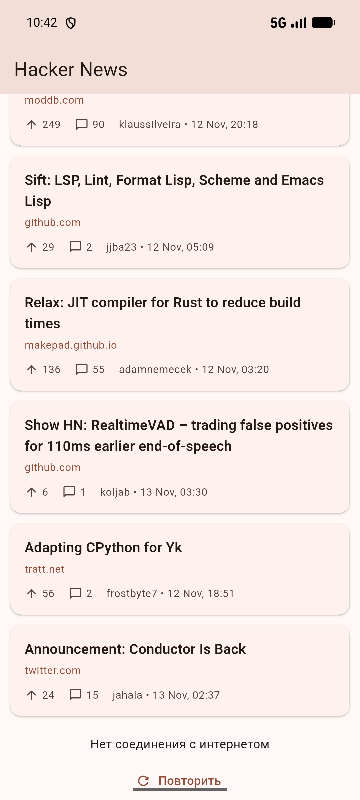
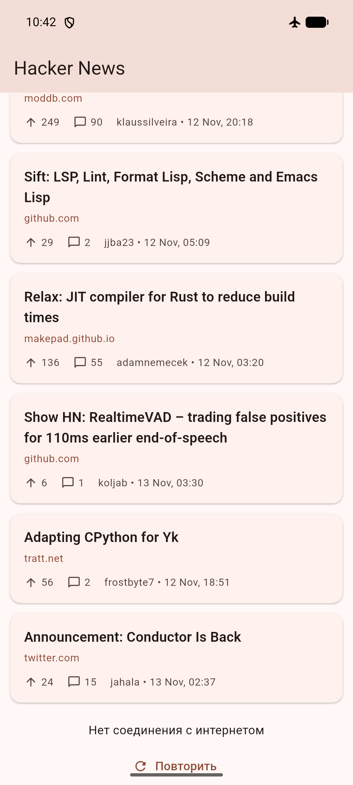

# Hacker News Reader

Мобильное приложение на Flutter для чтения топовых новостей Hacker News.
Учебный проект (Midterm) по кроссплатформенной разработке.

## Возможности

- список топовых историй Hacker News;
- индикатор загрузки и экран ошибки с кнопкой «Повторить»;
- pull-to-refresh и бесконечная прокрутка (пагинация по 20 историй);
- открытие статьи в браузере, для постов без ссылки открывается обсуждение;
- светлая и тёмная темы (Material 3).

## Скриншоты

| Список новостей | Ошибка сети |
| --- | --- |
|  |  |

## Технологии

| Задача | Решение |
| --- | --- |
| Платформа | Flutter (проверено на Android) |
| REST API | [Hacker News API](https://github.com/HackerNews/API) через `dio` |
| State management | `flutter_bloc` (BLoC), `equatable`, `bloc_concurrency` |
| Dependency injection | `get_it` |
| Тесты | `flutter_test`, `bloc_test`, `mocktail` |

## Архитектура

Feature-First + Clean Architecture. Зависимости направлены внутрь:
`presentation -> domain <- data`.

~~~
lib/
├── core/                      # общее: константы, ошибки, Dio-клиент, Result
├── features/news/
│   ├── data/                  # datasource (Dio), модели (DTO), репозиторий
│   ├── domain/                # entity, контракт репозитория, use case
│   └── presentation/          # BLoC (events/states), страница, виджеты
├── injection_container.dart   # регистрация зависимостей (get_it)
├── app.dart                   # MaterialApp и темы
└── main.dart
~~~

Поток данных: `NewsPage` отправляет события в `NewsBloc`, BLoC вызывает use case
`GetTopStories`, репозиторий обращается к datasource (Dio) и возвращает
`Result` (данные или `Failure`), BLoC отдаёт `NewsState`, UI перерисовывается.

Обработка ошибок: Dio-исключения превращаются в `AppException`
(сеть, сервер, парсинг), репозиторий преобразует их в `Failure`,
BLoC и UI показывают понятное сообщение.

## Запуск

Требуется Flutter SDK и Android-эмулятор или телефон.

~~~bash
git clone https://github.com/ksulaimanov/news_reader.git
cd news_reader
flutter pub get
flutter run
~~~

Сборка release APK:

~~~bash
flutter build apk --release
# build/app/outputs/flutter-apk/app-release.apk
~~~

## Тесты

~~~bash
flutter test
~~~

Покрыты репозиторий (маппинг ошибок), `NewsBloc` (загрузка, обновление,
пагинация, ошибки) и основные состояния экрана.
